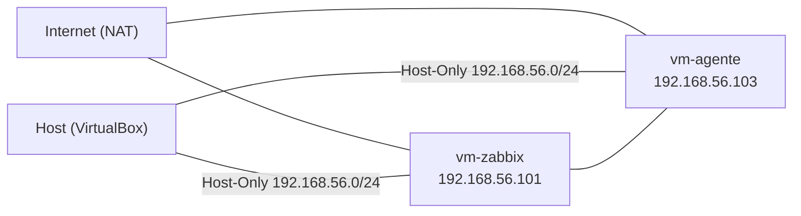

# homelab-soc-infra

Home lab de monitoramento e detecção rodando em VMs leves no VirtualBox. O objetivo é praticar infraestrutura e operações de SOC em hardware modesto e documentar cada etapa.

## Ambiente

- **Host:** PC com 16 GB de RAM e 4 núcleos
- **Hipervisor:** Oracle VirtualBox
- **Sistema das VMs:** Ubuntu Server 26.04 LTS
- **Armazenamento:** arquivos das VMs em um disco separado do sistema
- **Acesso:** SSH a partir do host

## Topologia

Cada VM tem duas placas de rede: a primeira em NAT, para acesso à internet, e a segunda em Host-Only, para o tráfego do lab e o acesso do host. Os IPs vêm de DHCP e podem mudar.

## VMs

| VM | Função | Redes | IP Host-Only |
|---|---|---|---|
| vm-zabbix | Servidor de monitoramento (Zabbix e Grafana) | NAT + Host-Only | 192.168.56.101 |
| vm-agente | Máquina monitorada (agente Zabbix) | NAT + Host-Only | 192.168.56.103 |

## Práticas aplicadas

- VM base limpa com snapshot, usada para criar todos os clones
- Clones completos com novos endereços MAC e novo `machine-id`
- Hostname próprio em cada VM
- Snapshot `rede-ok` em cada VM depois de validar a comunicação entre elas
- Acesso por SSH, sem usar o console do VirtualBox no dia a dia

## Status

- [x] VM base com Ubuntu Server e snapshot
- [x] Rede Host-Only e clones (`vm-zabbix`, `vm-agente`)
- [x] SSH funcionando e ping entre as VMs
- [ ] Zabbix server na `vm-zabbix` e agente na `vm-agente`
- [ ] Grafana com dashboards de CPU, memória, disco e rede
- [ ] Suricata com leitura de `eve.json` e regras Sigma
- [ ] Wazuh com alertas analisados e mapeados no MITRE ATT&CK
- [ ] Write-ups dos testes e dos alertas

## Como reproduzir

1. Instale o VirtualBox e aponte a pasta padrão de máquinas para um disco com espaço livre.
2. Baixe a ISO do Ubuntu Server LTS e crie a VM base (2 GB de RAM, 1 CPU, 20 GB de disco).
3. Instale o sistema, atualize os pacotes, instale o `openssh-server` e tire um snapshot.
4. Ative o Adaptador 2 em Host-Only e crie os clones com novos endereços MAC.
5. Em cada clone, ajuste o hostname e gere um novo `machine-id`.
6. Teste o SSH a partir do host e o `ping` entre as VMs.

## Próximos passos

As próximas etapas e os resultados ficam documentados neste repositório, com prints, comandos usados e o que foi aprendido em cada uma.
