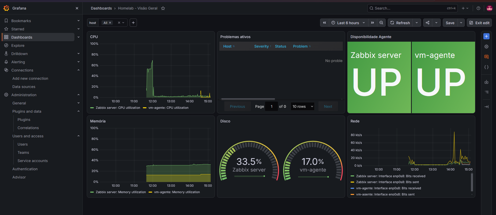
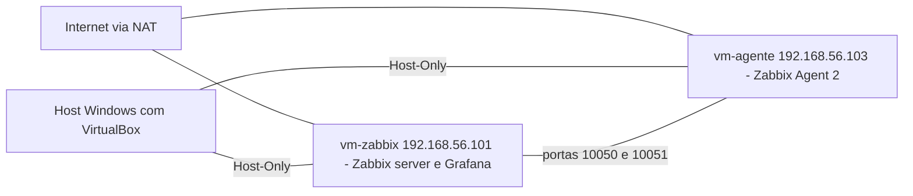
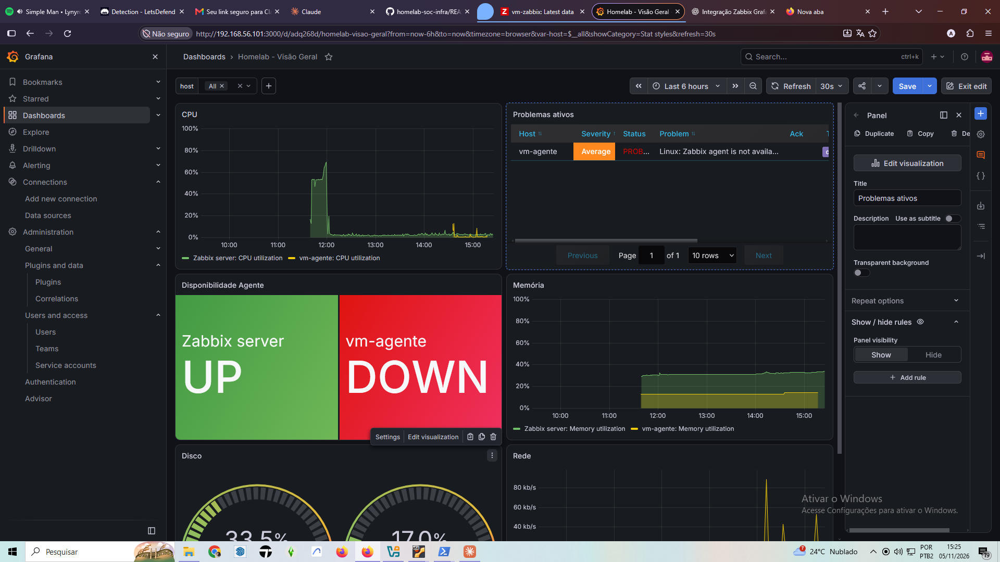
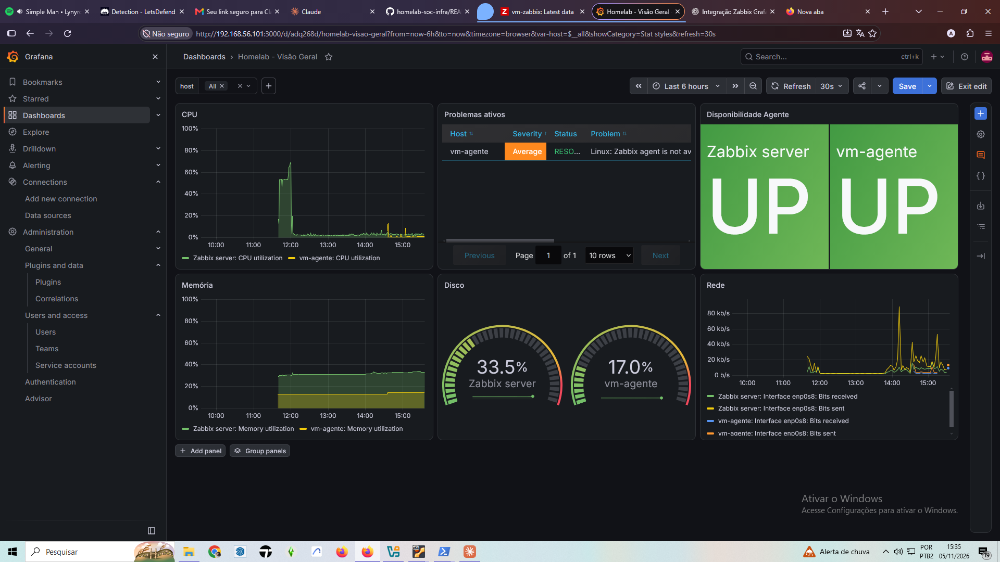
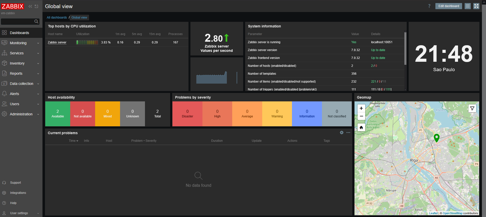
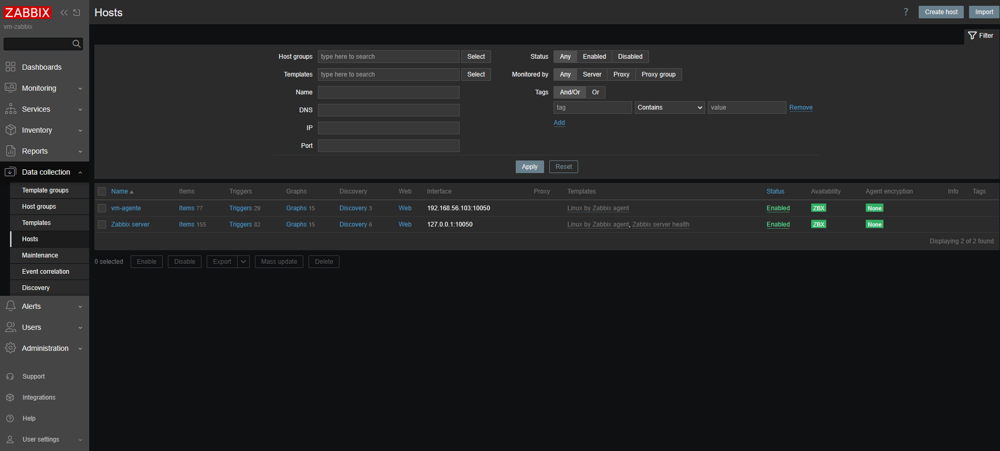
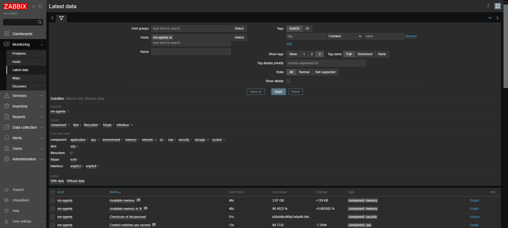

# homelab-soc-infra

Home lab de monitoramento e detecção rodando em VMs leves no VirtualBox. O objetivo é praticar infraestrutura e operações de SOC em hardware modesto e documentar cada etapa, incluindo os problemas encontrados e como foram resolvidos.



## Ambiente

- **Host:** Windows, Ryzen 3 3200G (4 núcleos), 16 GB de RAM
- **Hipervisor:** Oracle VirtualBox 7.2.22
- **Sistema das VMs:** Ubuntu Server 26.04.1 LTS
- **Armazenamento:** arquivos das VMs em um disco separado do sistema
- **Acesso:** SSH a partir do host

### Versões

| Componente | Versão | VM |
|---|---|---|
| Zabbix server e frontend | 7.0.32 | vm-zabbix |
| Zabbix Agent 2 | 7.0.x | vm-zabbix e vm-agente |
| MariaDB | 11.8.6 | vm-zabbix |
| Apache | 2.4.66 | vm-zabbix |
| PHP-FPM | 8.5 | vm-zabbix |
| Grafana | 13.3.0 | vm-zabbix |
| Plugin Zabbix para Grafana | 6.10.2 | vm-zabbix |

## Topologia



Se o diagrama acima não aparecer no seu leitor de Markdown, esta é a mesma topologia em texto:

```
Windows (Ryzen 3 3200G, 16 GB) + VirtualBox 7.2.22
 ├─ vm-zabbix  192.168.56.101  (4 GB, 2 vCPU)
 │    Apache + PHP-FPM → painel Zabbix (/zabbix)
 │    Zabbix server → MariaDB
 │    Grafana :3000 → API do Zabbix
 └─ vm-agente  192.168.56.103  (3 GB, 2 vCPU)
      Zabbix Agent 2 :10050

Redes: NAT (internet) + Host-Only 192.168.56.0/24 (lab e acesso do host)
IPs fixos: Windows .1 | vm-zabbix .101 | vm-agente .103 (DHCP da Host-Only desligado)
```

Cada VM tem duas placas de rede: a primeira em NAT, para acesso à internet, e a segunda em Host-Only, para o tráfego do lab e o acesso do host.

Os endereços da Host-Only são fixos: o host Windows usa `192.168.56.1` e cada VM tem seu IP configurado via netplan em `/etc/netplan/60-hostonly.yaml`. O servidor DHCP da Host-Only fica desligado, para que nenhum endereço mude depois de um reboot.

```yaml
# /etc/netplan/60-hostonly.yaml (vm-zabbix)
network:
  version: 2
  ethernets:
    enp0s8:
      dhcp4: false
      addresses: [192.168.56.101/24]
```

## VMs

| VM | Função | Recursos | IP Host-Only |
|---|---|---|---|
| vm-zabbix | Servidor de monitoramento (Zabbix, MariaDB, Apache, Grafana) | 4 GB RAM, 2 vCPU | 192.168.56.101 |
| vm-agente | Máquina monitorada (Zabbix Agent 2) | 3 GB RAM, 2 vCPU | 192.168.56.103 |

## Como funciona

- **Coleta:** o servidor consulta o agente na porta 10050 (checagens passivas) e o agente envia dados ao servidor na 10051 (checagens ativas). Os dados ficam no MariaDB.
- **Painel do Zabbix:** servido pelo Apache com PHP-FPM em `/zabbix`.
- **Grafana:** consulta a API JSON-RPC do Zabbix (`/zabbix/api_jsonrpc.php`) pelo plugin e monta os dashboards na porta 3000.

## Grafana

### Autenticação

O Grafana acessa o Zabbix com um **usuário de serviço dedicado** (`grafana-user`), seguindo o princípio do menor privilégio:

- Role do tipo *User*, com acesso à API e sem acesso ao frontend
- Permissão somente de **leitura** nos host groups `Zabbix servers` e `Linux servers`
- Autenticação por **API token**, revogável a qualquer momento em *Users → API tokens*
- Token sem expiração por ser um lab isolado em rede Host-Only
- Nenhuma credencial versionada neste repositório

As senhas padrão do Admin do Zabbix e do admin do Grafana foram alteradas.

## Suricata (IDS)
- Versão 8.0.3 na vm-agente, modo IDS, AF_PACKET na `enp0s8` (Host-Only)
- Regras ET Open via `suricata-update`: 69.354 no total, 53.383 ativas; carga em ~19 s, ~424 MB de RAM
- `HOME_NET: 192.168.56.0/24`; `EXTERNAL_NET: "any"` por decisão de laboratório (ver write-up 02)
- Write-ups: [01 – resposta com privilégio de root](writeups/01-suricata-id-root.md) · [02 – varredura interna](writeups/02-suricata-varredura-nmap.md)

### Dashboard "Homelab - Visão Geral"

Arquivo: [`grafana/dashboards/homelab-visao-geral.json`](grafana/dashboards/homelab-visao-geral.json)

| Painel | Visualização | Dado do Zabbix |
|---|---|---|
| Disponibilidade Agente | Stat (UP/DOWN) | `Zabbix agent availability` |
| Problemas ativos | Zabbix Problems | Problemas e recuperações recentes |
| CPU | Time series | `CPU utilization` |
| Memória | Time series | `Memory utilization` |
| Disco | Gauge | `FS [/]: Space: Used, in %` |
| Rede | Time series | `Interface enp0s8: Bits received/sent` |

Todos os painéis usam a variável `$host`, que permite filtrar uma VM ou ver todas.

**Para importar:** Dashboards → New → Import → envie o JSON e selecione o data source do Zabbix.

## Teste de detecção: queda do agente

Simulação de uma falha na vm-agente para validar se o monitoramento detecta o problema e registra a recuperação.

**Procedimento**

```bash
# na vm-agente
sudo systemctl stop zabbix-agent2
# aguardar a detecção
sudo systemctl start zabbix-agent2
```

**Resultado**

| Etapa | O que aconteceu |
|---|---|
| Antes | As duas VMs em UP, sem problemas ativos |
| Falha | O card da vm-agente mudou para DOWN e o problema *Linux: Zabbix agent is not available* (severidade Average) apareceu no painel |
| Recuperação | Depois de religar o agente, o card voltou para UP e o problema ficou como RESOLVED |

| Métrica | Valor |
|---|---|
| Tempo até a detecção | 2 minutos |
| Duração do problema | 5 minutos (Monitoring → Problems → History) |

| Antes | Durante | Depois |
|---|---|---|
|  |  |  |

O Zabbix não marca o agente como indisponível na primeira falha: ele faz novas tentativas antes, o que evita falsos positivos por uma oscilação momentânea.

## Problemas resolvidos

### 1. Apache não subia
- **Sintoma:** o painel do Zabbix não abria.
- **Causa:** faltavam os módulos `proxy` e `proxy_fcgi`, usados pelo Apache para encaminhar as requisições ao PHP-FPM.
- **Correção:** `sudo a2enmod proxy proxy_fcgi` e reload do Apache.

### 2. Esquema do banco incompleto
- **Sintoma:** erros na inicialização do Zabbix server.
- **Causa:** o servidor de banco não estava instalado, e uma importação interrompida deixou o esquema pela metade.
- **Correção:** instalação do MariaDB, recriação do banco e nova importação completa do esquema.

### 3. Grafana travado em "Testing..."
- **Sintoma:** o *Save & test* do data source nunca concluía.
- **Investigação:** a API JSON-RPC respondia normalmente, então o problema não era conectividade, e sim autenticação.
- **Causa:** o Apache não repassava o cabeçalho `Authorization` ao PHP-FPM.
- **Correção:** em `/etc/apache2/apache2.conf`:
  ```apache
  SetEnvIfNoCase ^Authorization$ "(.+)" HTTP_AUTHORIZATION=$1
  ```
  seguido de `sudo apache2ctl configtest` e `sudo systemctl reload apache2`.
- **Aprendizado:** endpoint respondendo não significa autenticação funcionando. É preciso checar o repasse de cabeçalhos entre o servidor web e a aplicação.

### 4. Bloqueio de conta e credenciais divergentes
- **Sintoma:** o Grafana parava de autenticar e a conta era bloqueada por tentativas seguidas.
- **Causa:** o Grafana usava a conta Admin, e as senhas configuradas nos dois lados divergiram.
- **Correção:** criação de um usuário de serviço somente leitura e autenticação por API token. Trocar a senha do Admin não afeta mais a integração.

### 5. Host "sumido" no Grafana
- **Sintoma:** a variável `$host` listava só 1 dos 2 hosts.
- **Investigação:** um `host.get` direto na API, com o token do `grafana-user`, retornou os 2 hosts. Logo, a permissão no Zabbix estava correta e o problema estava no Grafana.
  ```bash
  read -s TOKEN
  curl -s -X POST http://127.0.0.1/zabbix/api_jsonrpc.php \
    -H "Content-Type: application/json-rpc" \
    -H "Authorization: Bearer $TOKEN" \
    -d '{"jsonrpc":"2.0","method":"host.get","params":{"output":["host","name"]},"id":1}'
  ```
- **Causa:** o cache do plugin guardava a resposta de antes da liberação do host group `Linux servers`.
- **Correção:** restart do `grafana-server` e Cache TTL do data source reduzido para 5 minutos.

### 6. Saturação de CPU
- **Sintoma:** lentidão no painel e uso de CPU perto de 70% na vm-zabbix.
- **Causa:** com 1 vCPU, o PHP-FPM saturava a VM.
- **Correção:** vm-zabbix com 2 vCPUs.

### 7. Configuração de rede amarrada ao MAC da VM base
- **Sintoma:** o netplan da vm-zabbix tinha `match: macaddress` com o MAC da VM base.
- **Causa:** o instalador amarra a placa ao MAC; o clone herdou essa configuração, que não correspondia mais à placa da VM. A placa NAT dos clones também manteve o MAC da VM base.
- **Correção:** remoção do `match`/`set-name`, deixando a configuração pelo nome da interface (`enp0s3`). A vm-zabbix recebeu um MAC novo com `VBoxManage modifyvm --macaddress1 auto`.

### 8. Conflito de IP entre as VMs
- **Sintoma:** a vm-zabbix parou de responder no `.101` depois de configurar o IP fixo.
- **Investigação:** o `60-hostonly.yaml` da vm-zabbix tinha `192.168.56.103`, o IP da vm-agente, e o `ip -br a` confirmou o endereço errado.
- **Causa:** configuração copiada de uma VM para a outra sem ajustar o IP.
- **Correção:** acesso temporário com `ip addr add` pelo console, arquivo recriado com `tee` e `netplan apply`; cache ARP do Windows limpo com `netsh interface ip delete arpcache`.
- **Aprendizado:** durante o conflito, o Zabbix chegou a mostrar a vm-agente como UP porque consultava a própria vm-zabbix. Um status UP precisa ser confirmado pelo horário da última coleta.

### 9. IP do host dependente do DHCP
- **Sintoma:** o Windows estava com `192.168.56.102` na Host-Only, recebido pelo DHCP do VirtualBox.
- **Risco:** desligar o DHCP cortaria o acesso do host às VMs.
- **Correção:** adaptador do host fixado em `192.168.56.1` antes de desligar o DHCP.

## Práticas aplicadas

- VM base limpa com snapshot, usada para criar todos os clones
- Clones completos com novos endereços MAC e novo `machine-id`
- Hostname próprio em cada VM
- Snapshots a cada marco validado (`rede-ok`, `fase1-zabbix-grafana-ok`, `fase1-agente-ok`, `fase0-ip-fixo`)
- IPs fixos via netplan e DHCP da Host-Only desligado
- MAC único em cada placa de rede dos clones
- Acesso por SSH, sem usar o console do VirtualBox no dia a dia
- Conta de serviço com menor privilégio para integrações
- `.gitignore` e verificação de segredos antes de cada commit

## Status

- [x] VM base com Ubuntu Server e snapshot
- [x] Rede Host-Only e clones (`vm-zabbix`, `vm-agente`)
- [x] SSH funcionando e ping entre as VMs
- [x] Zabbix server na `vm-zabbix` e agente na `vm-agente`
- [x] Grafana com dashboards de CPU, memória, disco, rede, disponibilidade e problemas
- [x] Teste de detecção da queda do agente, com prints
- [x] IPs fixos, DHCP da Host-Only desligado e MACs únicos
- [x] Suricata na vm-agente com regras ET Open e leitura do `eve.json`
- [ ] Regras Sigma
- [ ] Wazuh com alertas analisados e mapeados no MITRE ATT&CK
- [ ] Write-ups dos testes e dos alertas

## Como reproduzir

1. Instale o VirtualBox e aponte a pasta padrão de máquinas para um disco com espaço livre.
2. Baixe a ISO do Ubuntu Server LTS e crie a VM base (2 GB de RAM, 1 CPU, 20 GB de disco).
3. Instale o sistema, atualize os pacotes, instale o `openssh-server` e tire um snapshot.
4. Ative o Adaptador 2 em Host-Only e crie os clones com novos endereços MAC (confira também o Adaptador 1).
5. Em cada clone, ajuste o hostname e gere um novo `machine-id`.
6. Fixe o IP do host na Host-Only (`192.168.56.1`), configure IP fixo em cada VM via netplan e desligue o DHCP da Host-Only.
7. Teste o SSH a partir do host e o `ping` entre as VMs.
8. Na vm-zabbix, instale Zabbix server, frontend e agente 2 com MariaDB, Apache e PHP-FPM (repositório oficial do Zabbix 7.0). Dê 4 GB de RAM e 2 vCPUs a essa VM.
9. Na vm-agente, instale o Zabbix Agent 2 com `Server` e `ServerActive` apontando para `192.168.56.101` e `Hostname=vm-agente`.
10. Instale o Grafana e o plugin do Zabbix na vm-zabbix, crie o usuário de serviço e o token, e importe o dashboard deste repositório.

## Evidências

### Painel do Zabbix


### Hosts monitorados


### Dados coletados da vm-agente


## Próximos passos

- **Suricata:** detecção de rede na vm-agente, com análise dos eventos do `eve.json`
- **Regras Sigma:** registrar o raciocínio de detecção em formato padrão
- **Wazuh:** SIEM/EDR com alertas mapeados no MITRE ATT&CK
- **Write-ups:** análise de tráfego com Wireshark e labs de rede no Cisco Packet Tracer
