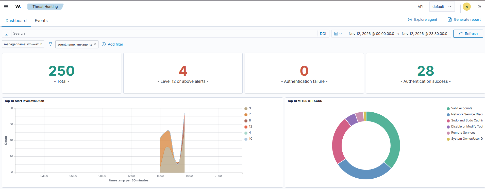
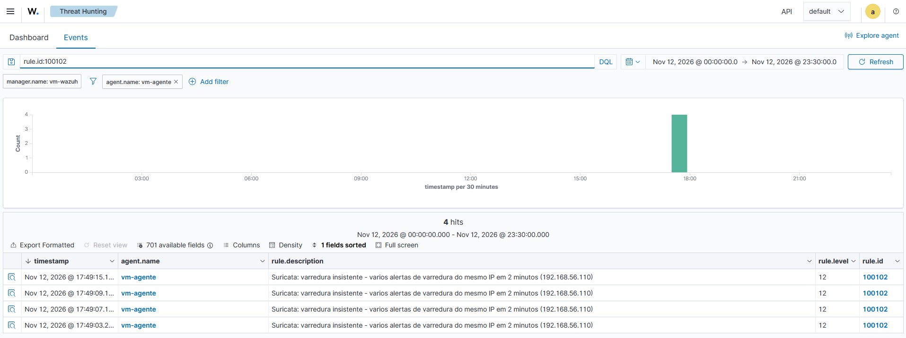

# Write-up 05: Detecção de varredura e regra de correlação no Wazuh

## Objetivo
Transformar os alertas de varredura do Suricata, que chegavam ao Wazuh como eventos genéricos de nível 3, em uma detecção priorizada (regra 100101) e criar uma regra de correlação (100102) que separe um alerta isolado de uma varredura insistente.

## Ambiente
- SIEM: Wazuh 4.14.10 na vm-wazuh (192.168.56.110)
- Sensor: Suricata 8.0.3 na vm-agente (192.168.56.103), `EXTERNAL_NET: "any"` (ver write-up 02)
- Atacante interno: vm-wazuh, com Nmap 7.94
- Regras versionadas em [`wazuh/rules/local_rules.xml`](../wazuh/rules/local_rules.xml)

## As regras

```xml
<rule id="100101" level="8">
  <if_sid>86601</if_sid>
  <field name="alert.signature_id">^2001219$|^2003068$|^2002910$|^2018489$|^2010935$|^2010936$|^2010937$|^2010939$</field>
  <description>Suricata: varredura de rede detectada - $(alert.signature)</description>
  <mitre><id>T1046</id></mitre>
  <group>reconhecimento,</group>
</rule>

<rule id="100102" level="12" frequency="5" timeframe="120">
  <if_matched_sid>100101</if_matched_sid>
  <same_field>src_ip</same_field>
  <description>Suricata: varredura insistente - varios alertas de varredura do mesmo IP em 2 minutos ($(src_ip))</description>
  <mitre><id>T1046</id></mitre>
  <group>reconhecimento,correlacao,</group>
</rule>
```

- **100101:** cada alerta de uma das 8 assinaturas de varredura observadas vira nível 8, com a técnica T1046.
- **100102:** regra de correlação. Ela não avalia um evento isolado: conta ocorrências da 100101. Com 5 ocorrências do mesmo IP de origem (`same_field src_ip`) em 120 segundos, gera um alerta de nível 12.

## Procedimento
1. Regras gravadas no Manager a partir do arquivo do repositório (`scp` + cópia para `/var/ossec/etc/rules/`), validadas com `wazuh-analysisd -t` e carregadas com o reinício do Manager.
2. Varreduras da vm-wazuh contra a vm-agente: `nmap -sS -T4` e `nmap -O`.
3. Contagem dos alertas no `alerts.json` do Manager, filtrando pelo horário de início do teste.

## Resultados

**Primeira versão (comparação pelo nome com `^ET SCAN|^GPL SCAN`):** nenhum alerta 100101. O diagnóstico em duas pontas mostrou onde o evento parou:

| Etapa | Resultado |
|---|---|
| Suricata (`eve.json` na vm-agente) | 24 alertas de 8 assinaturas ET SCAN, além de 10 de anomalia ICMP |
| Wazuh (`alerts.json` no Manager) | Os mesmos eventos, todos classificados na regra genérica 86601 |

Conclusão: os eventos chegavam, mas a comparação pelo nome não disparava. A regra passou a comparar pelo ID das assinaturas, como já tinha sido necessário na regra 100100 (write-up 04).

**Segunda versão (comparação pelo ID):**

| Regra | Nível | Ocorrências | Assinaturas |
|---|---|---|---|
| 100101 | 8 | 18 | NMAP OS Detection Probe (3), Potential SSH Scan OUTBOUND (7), Suspicious inbound to MSSQL, mySQL, Oracle SQL e PostgreSQL (2 cada) |
| 100102 | 12 | 4 | Correlação: varredura insistente a partir de 192.168.56.110 |

## Interpretação
- A correlação funcionou: 18 alertas de varredura do mesmo IP em poucos segundos geraram alertas de nível 12, que aparecem no indicador "Level 12 or above" do Dashboard. Um alerta isolado de varredura continua em nível 8.
- A 100102 disparou 4 vezes para a mesma varredura, porque a contagem recomeça a cada 5 ocorrências. Num SOC, isso gera ruído para o analista. Ajuste previsto: o atributo `ignore` na regra, para suprimir novos alertas do mesmo tipo por alguns minutos depois do primeiro.
- O alerta "Potential SSH Scan OUTBOUND" aparece com a direção errada (efeito do `EXTERNAL_NET: "any"`, ver write-up 02), mas continua sendo atividade de varredura e foi mantido na regra.
- A comparação pelo nome da assinatura falhou em duas regras diferentes; a causa exata não foi isolada (uma hipótese é o tratamento do espaço no padrão). A comparação pelo ID é a escolha mais robusta e foi adotada como padrão do laboratório.

## Possíveis falsos positivos
- Ferramentas legítimas de inventário ou de varredura de vulnerabilidades executadas pela equipe de TI.
- Sistemas de monitoramento que testam muitas portas de vários hosts em sequência.

O tratamento esperado é uma lista de exceções com os IPs dessas ferramentas, e não desligar a regra.

## MITRE ATT&CK
- T1046 – Network Service Discovery (tática Discovery).

## Conclusão
O SIEM passou a diferenciar três situações: um alerta genérico do Suricata (nível 3), uma varredura detectada (nível 8) e uma varredura insistente do mesmo IP (nível 12). A investigação de por que a primeira versão não disparava foi feita comparando o mesmo evento nas duas pontas, no sensor e no SIEM, até achar a etapa em que a classificação falhava.

## Evidências

| Alertas de nível 12 no Dashboard | Alertas da regra 100102 |
|---|---|
|  |  |
