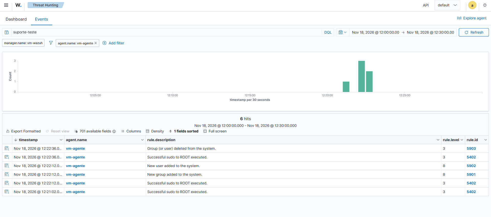
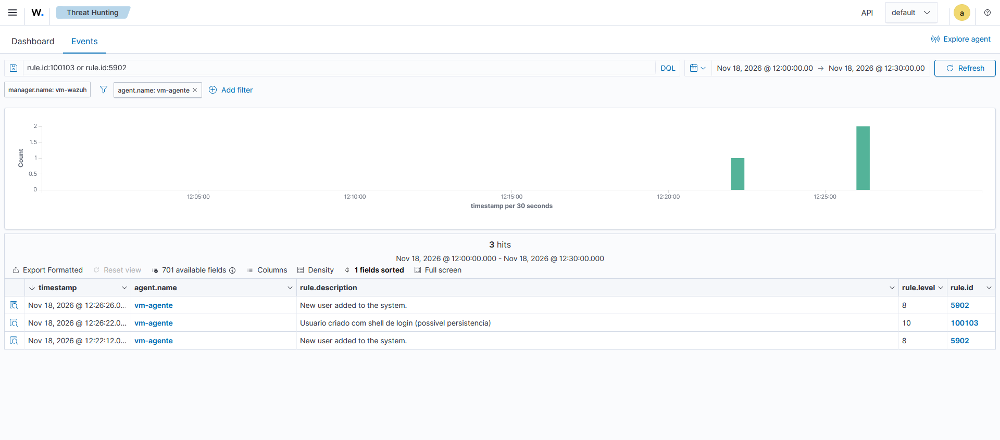
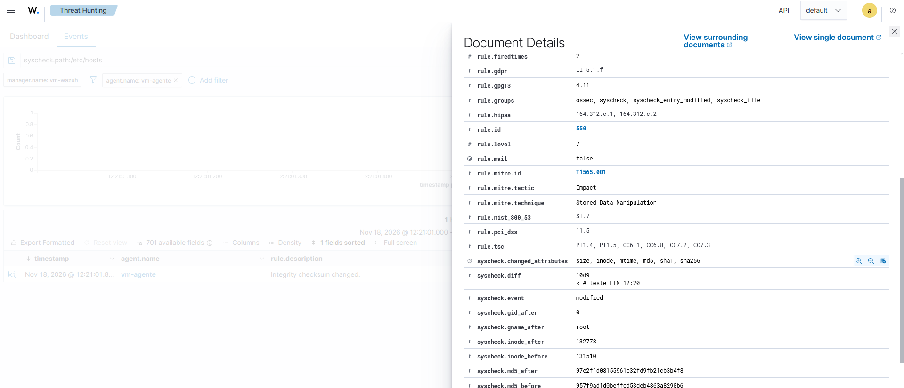

# Write-up 06: Ajuste da correlação, FIM em tempo real e criação de usuário com shell

## Objetivo
Fechar a Fase 4 com três ajustes de detecção:
1. Reduzir o ruído da regra de correlação 100102, que gerava vários alertas para uma única varredura.
2. Detectar em segundos a alteração de arquivos de configuração em `/etc`.
3. Diferenciar a criação de uma conta de serviço da criação de uma conta com shell de login, que é uma técnica de persistência.

## Ambiente
- SIEM: Wazuh 4.14.10 na vm-wazuh (192.168.56.110)
- Endpoint: vm-agente (192.168.56.103), com Wazuh Agent 4.14.10 e Suricata 8.0.3
- Regras versionadas em [`wazuh/rules/local_rules.xml`](../wazuh/rules/local_rules.xml)
- Data dos testes: 18/11/2026

## Teste 1: supressão de alertas repetidos na correlação

### Problema
No [write-up 05](05-wazuh-correlacao-varredura.md), uma única varredura com Nmap gerou 4 alertas de nível 12 da regra 100102. A contagem da regra recomeça a cada 5 ocorrências da 100101, e o analista recebia o mesmo incidente quatro vezes.

### Ajuste
```xml
<rule id="100102" level="12" frequency="5" timeframe="120" ignore="300">
```
O atributo `ignore="300"` faz a regra ficar 5 minutos sem gerar novo alerta depois de disparar.

### Resultado

| Regra | Antes (12/11) | Depois (18/11) |
|---|---|---|
| 100101 (varredura detectada, nível 8) | 18 | 21 |
| 100102 (varredura insistente, nível 12) | 4 | 1 |

A 100101 continua registrando cada evento, então os detalhes da varredura seguem disponíveis para a investigação. Só o alerta de alta prioridade foi deduplicado.

## Teste 2: FIM em tempo real no `/etc`

### Situação inicial
O `/etc` já estava no monitoramento de integridade (FIM) do agente, mas com varredura agendada a cada 12 horas. Uma alteração de configuração poderia levar horas para aparecer.

### Ajuste (no `ossec.conf` da vm-agente)
```xml
<directories realtime="yes" report_changes="yes">/etc</directories>
<directories>/usr/bin,/usr/sbin</directories>
```
- `realtime="yes"`: o agente reporta a mudança no momento em que ela acontece.
- `report_changes="yes"`: o alerta inclui o diff, que mostra o que mudou no arquivo.

### Procedimento
```bash
echo "# teste FIM $(date +%H:%M)" | sudo tee -a /etc/hosts
sudo sed -i '/# teste FIM/d' /etc/hosts
```

### Resultado
2 alertas da regra 550 (Integrity checksum changed) em segundos: um para a linha adicionada e outro para a remoção. O campo `syscheck.diff` mostra a linha alterada.

## Teste 3: criação de usuário com shell de login

### Problema
O Wazuh detecta a criação de qualquer usuário com a regra 5902 (nível 8). Uma conta de serviço sem shell (`nologin`) e uma conta com shell interativo recebiam o mesmo nível. Só a segunda permite login, e é o tipo de conta que um invasor cria para manter acesso.

### A regra
```xml
<rule id="100103" level="10">
  <if_sid>5902</if_sid>
  <match>shell=/bin/bash|shell=/usr/bin/bash|shell=/bin/sh|shell=/usr/bin/sh|shell=/bin/zsh|shell=/usr/bin/zsh</match>
  <description>Usuario criado com shell de login (possivel persistencia)</description>
  <mitre><id>T1136.001</id></mitre>
  <group>persistencia,</group>
</rule>
```
A regra só avalia eventos já classificados como "usuário criado" (5902) e procura o shell no log do `useradd`.

### Procedimento
```bash
sudo useradd -m -s /bin/bash suporte-teste
sudo useradd -r -s /usr/sbin/nologin servico-teste
sudo userdel -r suporte-teste; sudo userdel servico-teste
```

### Resultado

| Conta | Shell | Antes da regra | Depois da regra |
|---|---|---|---|
| suporte-teste | `/bin/bash` | 5902, nível 8 | 100103, nível 10 |
| servico-teste | `/usr/sbin/nologin` | — | 5902, nível 8 |

Os demais eventos do teste foram a 5901 (grupo criado, nível 8), a 5903 (usuário ou grupo removido, nível 3) e a 5402 (o próprio `sudo` do administrador, nível 3).

## Possíveis falsos positivos
- **FIM em `/etc`:** atualizações de pacotes e mudanças planejadas alteram arquivos de configuração. O tratamento é cruzar o horário com a janela de manutenção e com os eventos de `dpkg`, e não tirar o `/etc` do monitoramento.
- **Usuário com shell:** a contratação de um funcionário ou a criação de um administrador também geram a 100103. O alerta é para ser conferido com o pedido de criação da conta (chamado ou mudança aprovada).

## MITRE ATT&CK
- T1046 – Network Service Discovery (tática Discovery), na 100102
- T1136.001 – Create Account: Local Account (tática Persistence), na 100103
- A alteração em `/etc` não tem uma técnica única; dependendo do arquivo, pode indicar, por exemplo, T1543 (Create or Modify System Process) ou T1098 (Account Manipulation).

## Conclusão
Os três testes fecham a Fase 4. A correlação passou a gerar um alerta por incidente, o FIM detecta mudanças de configuração em segundos e mostra o que mudou, e a criação de conta com shell de login ficou acima da criação de contas de serviço. O padrão dos ajustes é o mesmo: partir da regra padrão do Wazuh e acrescentar o contexto que separa a atividade rotineira da suspeita, sem desligar a detecção original.

## Evidências

| Criação de usuário antes da regra | Depois da regra 100103 |
|---|---|
|  |  |


